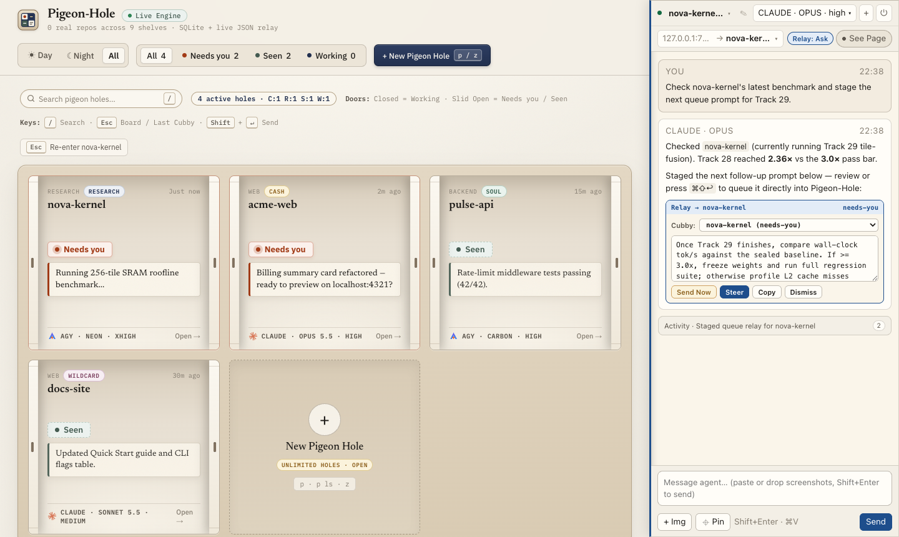
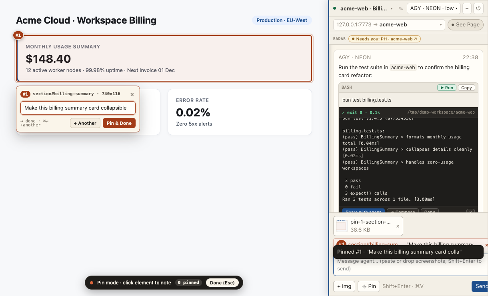
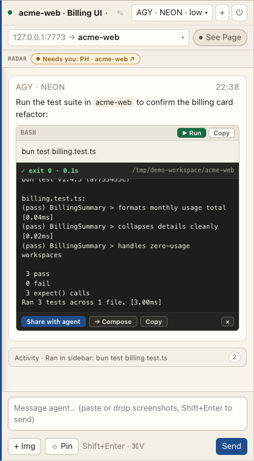
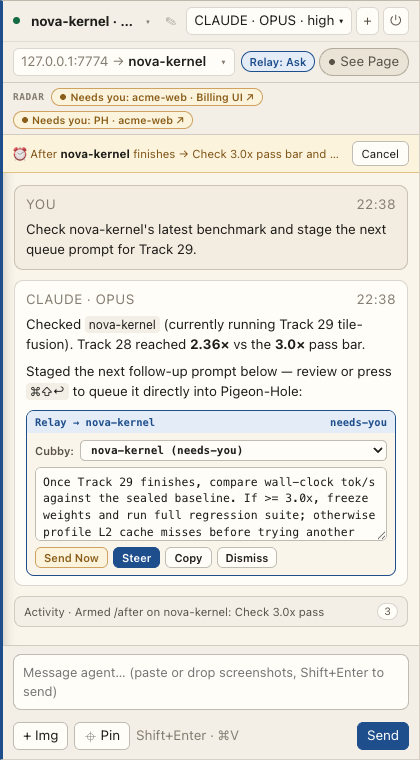
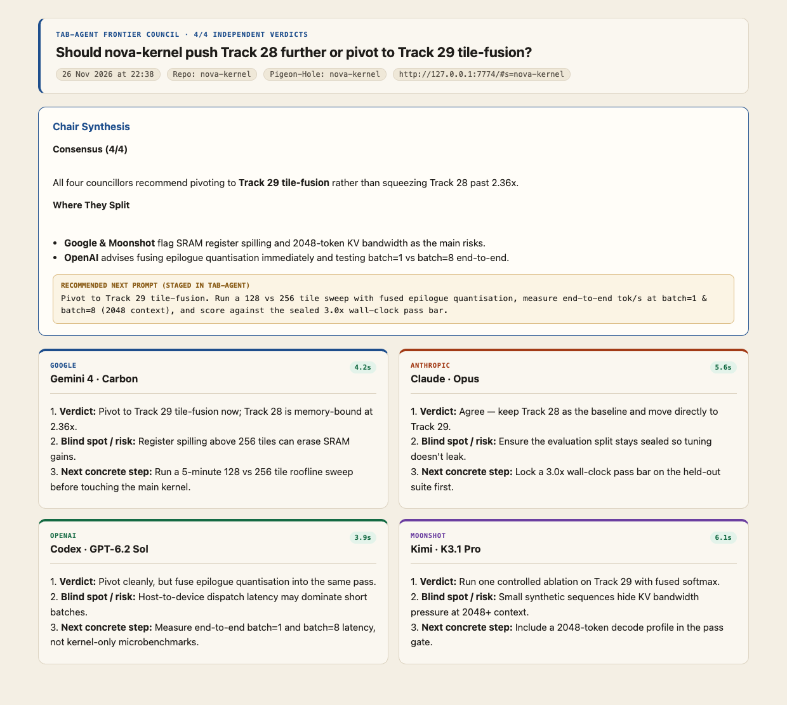

# Tab-Agent

A local-first **Chrome MV3 side-panel extension + Bun daemon** that pins a persistent **Claude Code** or **Antigravity (AGY)** CLI chat session to each browser tab — with opt-in DevTools inspection, in-page `⌖ Pin` element markup, inline `▶ Run` command execution, cross-tab Radar notifications, peer-to-peer tab messaging, and 1-click multi-model `/council`.

No API-key billing wrapper. No cloud sync. Your existing signed-in local CLI tools, backed by local SQLite WAL + FTS5.



---

## Why Tab-Agent?

Most browser AI sidebars are either stateless chat wrappers that can't touch your repo, or always-on DOM scrapers that attach invasive debugger hooks to every tab.

Tab-Agent takes a different angle:

- **One persistent CLI session per tab:** Every tab binds to a real local `claude` or `agy` conversation (`--resume` / `--conversation`), linked to the right local git repo and persisted in SQLite FTS5. Navigate across domains, reload the page, or reload the extension — your chat stays pinned to that tab.
- **Opt-in Inspect Gate (`See Page`, `⌘.`):** `chrome.debugger` stays physically detached while `See Page` is OFF. Click **See Page** to unlock live MCP tools (`tab_dom`, `tab_console`, `tab_network`, `tab_snapshot`, `tab_screenshot`, `tab_eval`, `tab_click`, `tab_fill`, `tab_reload`).
- **Zero-CDP in-page markup (`⌖ Pin`):** Click elements directly on any web page or local `.html` preview, drop numbered notes (`#1`, `#2`, …), and automatically attach `{ CSS selector + xpath + cropped PNG + note }` straight into your prompt — without toggling `See Page` or leaving Chrome.
- **Inline `▶ Run` terminal drawer:** Run shell code blocks from agent replies right inside the sidebar in the tab's linked repo `cwd`, see streaming output, and click **`Share with agent`** or **`→ Compose`** to close the loop.
- **Cross-Tab Radar:** Compact `Working: N` counter plus clickable `Needs you` / `Ready` / `Error` chips for every other tab (and optional Pigeon-Hole cubbies). Alerts survive daemon restarts and clear the instant you visit or click them.
- **Peer-to-peer session talk (`tab-peer`):** Ask any tab's agent to talk to another tab by repo name (`tab-peer list`, `tab-peer read <repo>`, `tab-peer send <repo> "..."`) instead of copy-pasting between tabs yourself.
- **1-Click Frontier `/council`:** Run independent answers in parallel across your installed local CLIs (Gemini `agy`, Claude `claude`, OpenAI `codex`, Moonshot `kimi`), generate a styled `Open ↗` `.html` comparison dossier, and stage a Relay Card automatically when supervising a Pigeon-Hole cubby.

---

## Screenshots

| In-page `⌖ Pin` markup (zero CDP) | Inline `▶ Run` terminal + `Share with agent` |
| --- | --- |
|  |  |

| Cross-Tab Radar (`Needs you` + `Working: N`) | 1-Click `/council` HTML Dossier |
| --- | --- |
|  |  |

---

## Quick Start (3 steps)

### Prerequisites
- **[Bun](https://bun.sh/)** (`>= 1.1`)
- **Google Chrome** (or Chromium `>= 116`)
- At least one signed-in local CLI agent:
  - **Claude Code** (`claude`) — auto-detected by default
  - **Antigravity CLI** (`agy`) — optional
  - **Codex CLI** (`codex`) and/or **Kimi Code** (`kimi`) — optional, used by `/council`

### 1. Install dependencies & start the local daemon
```bash
git clone https://github.com/Samuel-Tucker/tab-agent.git
cd tab-agent
bun install
./bin/tab-agent start
./bin/tab-agent status
```
The daemon listens strictly on `http://127.0.0.1:7752` and creates its SQLite database in `./data/tab-agent.sqlite` (gitignored).

### 2. Load the Chrome extension
1. Open `chrome://extensions`
2. Enable **Developer mode** (top-right)
3. Click **Load unpacked** and select the `extension/` folder inside this repo
4. *(Optional, for local `.html` previews)* Open Tab-Agent's extension **Details** and enable **Allow access to file URLs**

### 3. Open a tab and click the Tab-Agent toolbar icon
- Send a prompt with **`Shift+Enter`**
- Press **`⌘K`** (or click the chat title) to search, rename, move, or recover chats
- Press **`⌘.`** to toggle **See Page** (CDP inspection)
- Click **`⌖ Pin`** to annotate live page elements with cropped screenshots

---

## Commands & Workflows

### Slash commands in the sidebar
| Command | What it does |
| --- | --- |
| `/model <name> [effort]` | Switch runner/model (`opus`, `sonnet`, `haiku`, `neon`, `carbon`, `argon`, `hydrogen`) |
| `/effort <level>` | Adjust thinking effort (`low`, `medium`, `high`, `xhigh`, `max`) |
| `/council <question>` | Fan out in parallel across installed CLIs (`agy`, `claude`, `codex`, `kimi`), render an `Open ↗` `.html` comparison sheet, and stage a Relay Card on Pigeon-Hole tabs |
| `/council gemini,claude \| <question>` | Run `/council` on specific lanes only |
| `/after [cubby] <instruction>` | Wake this tab automatically when a Pigeon-Hole cubby finishes its current turn |
| `/new` / `/clear` | Reset underlying CLI session context / clear chat history |
| `/help` | Show command & shortcut cheat sheet |

### Peer-to-peer talk between tabs (`tab-peer`)
Every spawned agent has `bin/tab-peer` on its `PATH` (and Claude Code also has `peer_list`, `peer_read`, and `peer_send` MCP tools):

```bash
tab-peer list [query]
tab-peer read <repo-or-session> [--last 8]
tab-peer send <repo-or-session> "Can you check the API schema?" [--no-wait] [--timeout 120]
```

### Daemon CLI
```bash
./bin/tab-agent start        # Start background daemon on 127.0.0.1:7752
./bin/tab-agent stop         # Stop daemon and any running CLI turns cleanly
./bin/tab-agent reload       # Restart daemon cleanly
./bin/tab-agent status       # Print live JSON health check
```

---

## Architecture

```
Chrome Extension (MV3, per-tab side panel)
  ├── extension/background.js      Per-tab sidePanel lifecycle, tab sync, Radar badge, captureVisibleTab
  ├── extension/sidepanel.{html,css,js}  Warm-vellum chat UI, ⌘K switcher, Relay Cards, ▶ Run drawer
  ├── extension/picker.js          Shadow-DOM ⌖ Pin markup overlay + element picker
  └── extension/browser-runtime.js Opt-in CDP 1.3 bridge (detached when See Page is OFF)
            │
            ▼  HTTP + WebSocket (127.0.0.1:7752)
Local Bun Daemon
  ├── daemon/server.ts             REST + WS API, Radar state, CORS/localhost guard
  ├── daemon/db.ts                 SQLite WAL + FTS5 (sessions, bindings, messages, relays, triggers)
  ├── daemon/harnesses.ts          AGY & Claude Code stream-json runners, heartbeats, stall watchdog
  ├── daemon/url-repo.ts           4-tier URL -> local git repo resolver (pinned, localhost lsof, local scan, scratch)
  ├── daemon/shell-runner.ts       Inline ▶ Run terminal execution in linked repo cwd
  ├── daemon/peers.ts              Peer-to-peer session lookup & cross-tab messaging (hop-capped)
  ├── daemon/council.ts            Parallel multi-company /council runner + HTML dossier builder
  ├── daemon/pigeon-bridge.ts      Optional Pigeon-Hole bridge (Relay Cards, /after watcher, Radar)
  └── daemon/mcp-tab-bridge.mjs    Zero-dependency stdio MCP server for Claude Code
```

---

## Configuration (Environment Variables)

| Variable | Default | Purpose |
| --- | --- | --- |
| `TAB_AGENT_PORT` | `7752` | Local daemon port (binds strictly to `127.0.0.1`) |
| `TAB_AGENT_DEFAULT_HARNESS` | auto (`agy-neon` if `agy` exists, else `claude-sonnet`) | Default harness for new tab sessions |
| `TAB_AGENT_REPOS_DIR` | `~/Projects:~/repos:~/code:~/Developer` | Colon-separated roots scanned for local git repos |
| `TAB_AGENT_REPO_MAP` | `~/.tab-agent/repo-map.json` | Optional JSON catalogue of repos & aliases |
| `TAB_AGENT_CLAUDE_PERMISSION_MODE` | `bypass` | Headless Claude CLI mode: `bypass` (`--dangerously-skip-permissions`) or `acceptEdits` |
| `TAB_AGENT_STALL_MIN` | `30` | Stop a stuck turn after N minutes of zero CLI output |
| `TAB_AGENT_SEE_PAGE_IDLE_MIN` | `30` | Auto-detach `See Page` CDP after N minutes idle |
| `PIGEON_HOLE_URL` | `http://127.0.0.1:7742` | Optional Pigeon-Hole URL for Relay Cards & `/after` watchers |
| `TAB_AGENT_DISABLE_PIGEON` | unset (`0`) | Set to `1` to disable passive Pigeon-Hole WebSocket watching |

---

## Security Model

- **Localhost only:** The daemon binds strictly to `127.0.0.1` and rejects non-local origins (`403`).
- **Opt-in page access:** `chrome.debugger` is never attached until you explicitly click **See Page** (`⌘.`), and automatically detaches after 30 minutes of inactivity or when a chat moves off a tab.
- **Headless CLI permissions:** Because CLI turns run non-interactively (`claude -p`, `agy --print`), Tab-Agent runs them with skip-permissions enabled by default so tools like `Read` (for pasted screenshots) and `Bash` don't deadlock. If you prefer stricter Claude permissions, set `TAB_AGENT_CLAUDE_PERMISSION_MODE=acceptEdits` before starting the daemon.
- **No data leaves your machine** except through the local CLI agent providers you are already signed into.

---

## Development & Tests

```bash
bun test tests/     # Unit & integration suite (SQLite, harnesses, URL resolver, peers, /council, Pigeon-Hole bridge)
bun run ui-check    # Real-Chromium end-to-end check against an isolated daemon on :7762
```

See [CONTRIBUTING.md](CONTRIBUTING.md) for repo layout and upstream sync notes.

## License

[MIT](LICENSE)
